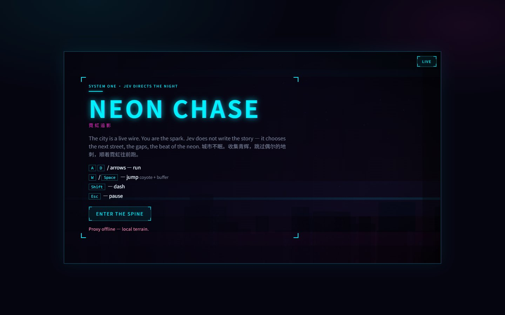
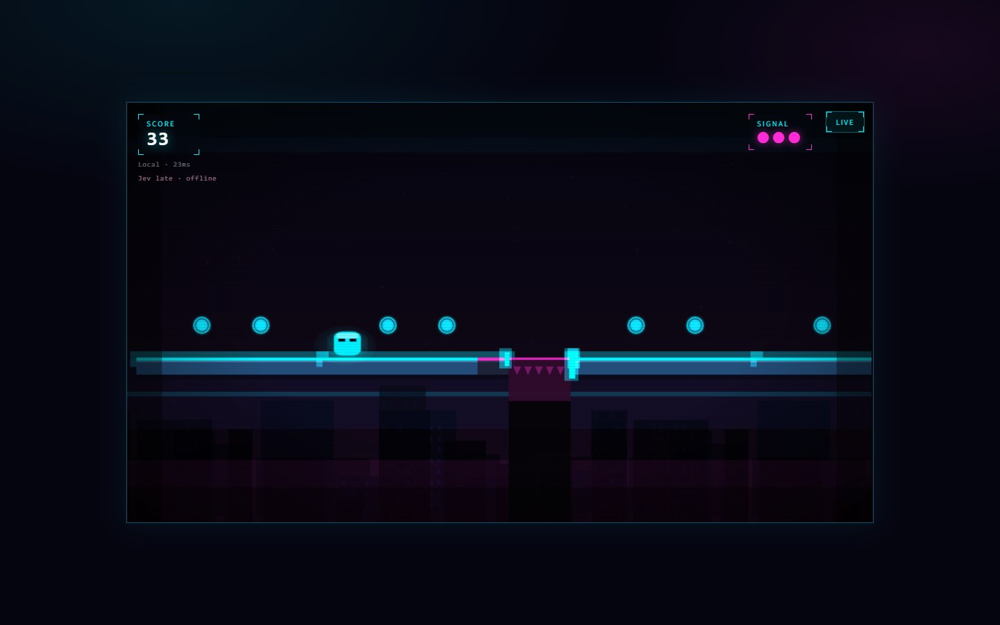

# 霓虹追影 · Neon Chase

一款霓虹风格的横向无尽跑酷游戏。沿街道自动前进，跳过坑洞与尖刺、冲刺、收集青色光球，以距离和连击争取更高分数。

## 游戏画面

2026-10-12 本地离线地形实机画面；截图时未连接模型代理。





## 已实现玩法

- 自动前进与左右移动、跳跃宽限和输入缓冲、短冲刺。
- 逐步变化的坑洞节奏、平台、尖刺、光球与连击得分。
- 3 点生命；尖刺扣血，落下结束本局；失败后可以立即重开。
- 暂停、静音、本机偏好，以及触屏操作按钮。
- 可选 TypeSafe Jev 结构化地形决策；代理失效时使用本地地形。

当前 `HUNTERS_ENABLED = false`，追逐者不参与玩法；不要将源码中的 Hunter 类视为当前已启用功能。

| 操作 | 输入 |
| --- | --- |
| 左右移动 | A、D 或方向键，另有持续自动前进 |
| 跳跃 | W、上方向键或空格 |
| 冲刺 | Shift |
| 开始 / 重开 | Enter，或界面按钮 |
| 暂停 / 静音 | Esc、P / M |

## 本地运行

本次使用 Node.js 24.15.0 和 npm。按锁文件安装，随后仅运行前端即可体验 fallback：

```sh
npm ci --ignore-scripts
npm run dev -w client -- --host 127.0.0.1
```

打开 <http://127.0.0.1:43123/>，点击 **ENTER THE SPINE**。代理离线提示不会阻止开始游戏。

可选代理：另开终端执行 `npm run dev:server`（默认 43124），或用 `npm run dev` 启动两端。配置模板见 [.env.example](.env.example)；没有 `TYPESAFE_API_KEY` 或请求超时时使用 fallback。密钥只应放在服务端，真实模型访问及费用不属于本次验证范围。

```sh
npm run build
npm run preview -w client -- --host 127.0.0.1
```

构建输出为 `client/dist/`。2026-10-12 已完成安装、fallback 开局、跳跃操作和生产构建。`npm test` 是项目已有的坑洞节奏与跳跃可达性检查命令，本次未重新执行完整测试集。

## 技术栈与目录

Phaser 3、TypeScript、Vite；Hono / Node.js 提供可选 Jev 代理。

- `client/src/game/`：实体、场景、特效与地形。
- `client/src/audio/`：程序化 Web Audio。
- `server/src/`：决策接口、问题定义与 fallback。
- `shared/`：平台长度、坑洞节奏、跳跃常量与类型。

## 当前限制

当前为单人无尽模式，没有多人、账号或联网排行榜。追逐者已关闭。模型只返回结构化选择，不生成图片或自由地图。构建会提示前端资源包较大，移动设备实际帧率未在本次验证。

## 素材与参考

角色、地形与霓虹纹理由项目图形代码生成，音乐和操作声由 Web Audio 合成。本次检查未发现独立美术或音频素材包。

美术打磨参考花间莉萝的视频 [《为什么你的独立游戏充满廉价感？》](https://www.bilibili.com/video/BV1q843z1EgF)，保留原有归属。Phaser 和其他依赖保留其自身许可。

## 许可证

本仓库尚未提供项目代码的 `LICENSE`，开源许可证待维护者确认。本说明不授予新的代码或素材许可。第三方依赖及素材保留各自原有条款。
